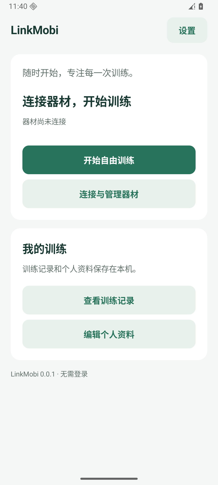
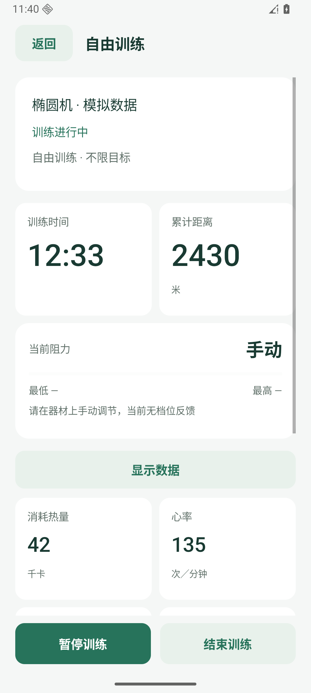
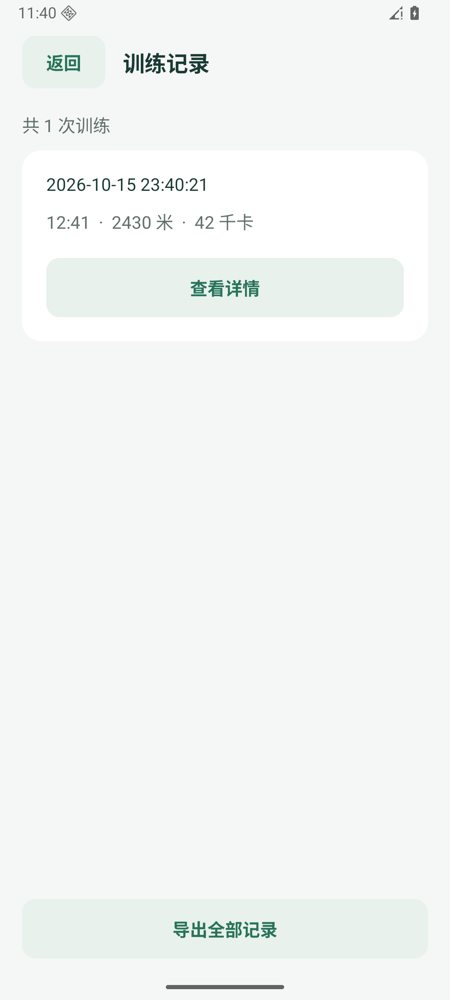
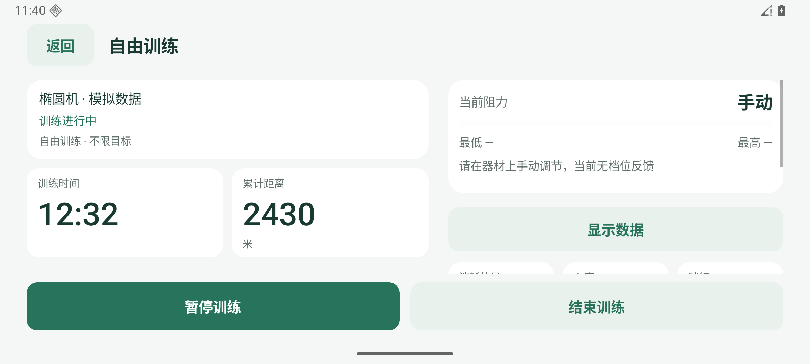

# LinkMobi

**简体中文** | [English](./README.en.md)

基于已停服的莫比健身 Android App 整理的非官方免登录简洁版，改造与打包全程使用 AI 完成。本仓库仅分享安装包，不含源代码，后续可能更新迭代版本。

原 App 版本：**莫比健身 4.5.16.1**。LinkMobi 使用独立版本号。

## 下载

**[下载 LinkMobi-0.0.1.apk](./LinkMobi-0.0.1.apk?raw=true)**

版本 `0.0.1` · Android 8.0 及以上 · 应用语言：简体中文

SHA-256：

```text
16432beff4d27a5de00a291655b599d478f0c669cbcf65570e187572b7a11e9a
```

## 功能

- 蓝牙连接器材、免登录自由训练。
- 本地个人资料、训练记录及 JSON 导出。
- 手机和平板适配，支持横竖屏。
- 椭圆机数据显示选择及智能阻力，具体能力取决于器材支持。

不恢复原厂云课程、在线比赛、社交、云端记录和固件下载，不解锁付费内容。已做模拟器验证；真实器材及 16 KB 内存页设备的兼容性仍待验证。

## 项目截图

截图来自 Android 模拟器，训练数据为模拟数据。

| 首页 | 自由训练 | 训练记录 |
| :---: | :---: | :---: |
|  |  |  |

横屏训练：



## 安装与使用

1. 下载 APK，在 Android 设备上打开，按系统提示允许安装。
2. 打开应用，设置个人资料；开启蓝牙，在“连接与管理器材”中授权并连接器材。
3. 开始自由训练，结束后查看本地记录，或导出 JSON 备份。

已有本项目旧版可覆盖安装。原官方版签名不同，需先备份可保存的数据，再卸载后安装；卸载会删除原应用的本地数据。

## 版本记录

`0.0.1` · 2026-10-15：LinkMobi 首个公开版本，统一应用与安装包名称，后续从 `0.0.2` 递增。

## 许可证

本项目采用 [Apache-2.0](./LICENSE) 许可证。
