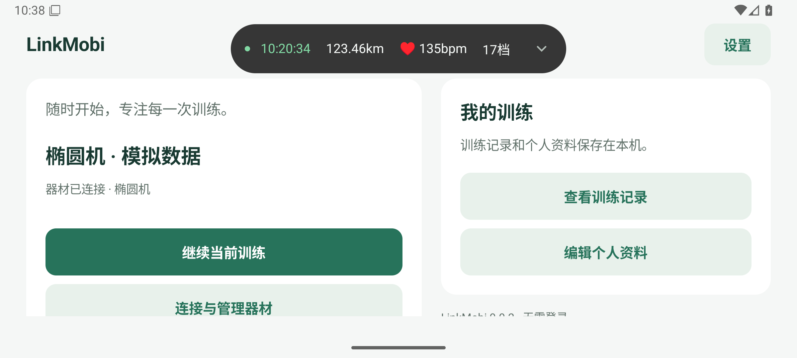
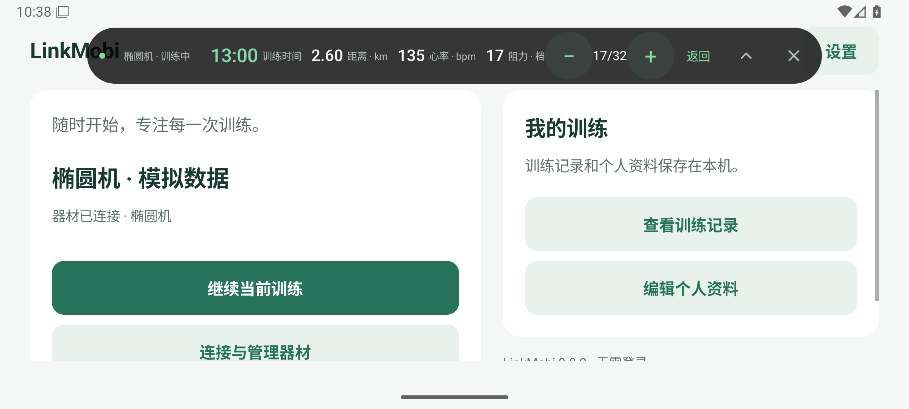

# LinkMobi

**简体中文** | [English](./README.en.md)

基于已停服的莫比健身 Android App 整理的非官方免登录简洁版，改造与打包全程使用 AI 完成。本仓库仅分享安装包，不含源代码，后续可能更新迭代版本。

原 App 版本：**莫比健身 4.5.16.1**。LinkMobi 使用独立版本号。

## 下载

**[下载 LinkMobi-0.0.2.apk](./LinkMobi-0.0.2.apk?raw=true)**

版本 `0.0.2` · 约 92.7 MiB · Android 8.0 及以上 · 应用语言：简体中文

SHA-256：

```text
e945f37fba98f451cd17d268d174d1475d28ab06563be3678179a0a3251c7549
```

## 0.0.2 新增：训练悬浮窗

训练时切换到其他 App，也能查看训练信息，并按器材能力调节阻力、速度或坡度。

- **尽量少占屏幕**：仅在顶部居中显示，宽度随内容变化；黑色半透明背景、绿色强调色和两端半圆的胶囊外形。避开状态栏与刘海后，额外顶部间距仅为 4dp，适合横屏使用；手机、平板及竖屏也可使用。
- **关键信息常驻**：收起时单行展示时间、距离、心率和器材指标。跑步机显示速度，有阻力反馈的器材显示档位，其余显示热量；缺失数据显示“—”。
- **展开即可调节**：点击数据条展开，按器材能力提供阻力、速度与坡度加减，以及返回训练、收起和关闭本次悬浮窗入口。智能阻力模式不提供手动阻力按钮，断连后提示数据停止更新并禁用控制。
- **自动显示与隐藏**：开始训练后离开训练页自动显示，返回训练页隐藏，结束训练后移除；暂停时保留。每次训练从收起状态开始，关闭只对本次训练生效。暂停、继续和结束仍在训练页操作。
- **设置保持简单**：只保留开启开关，默认关闭。开启时按系统提示授予“显示在其他应用上层”权限，未授权也可正常训练。

## 功能

- 蓝牙连接器材、免登录自由训练。
- 本地个人资料、训练记录及 JSON 导出。
- 手机和平板适配，支持横竖屏。
- 椭圆机数据显示选择及智能阻力，具体能力取决于器材支持。
- 顶部训练悬浮窗，支持跨 App 查看数据及按器材能力调节。

不恢复原厂云课程、在线比赛、社交、云端记录和固件下载，不解锁付费内容。已做模拟器验证；真实器材及 16 KB 内存页设备的兼容性仍待验证。

## 项目截图

以下为 0.0.2 的 Android 模拟器截图，训练数据为模拟数据。

顶部悬浮窗（横屏、收起）：



顶部悬浮窗（横屏、展开，保留阻力调节）：



| 首页 | 自由训练 | 训练记录 |
| :---: | :---: | :---: |
|  |  |  |

横屏训练：


## 安装与使用

1. 下载 APK，在 Android 设备上打开，按系统提示允许安装。
2. 打开应用，设置个人资料；开启蓝牙，在“连接与管理器材”中授权并连接器材。
3. 开始自由训练，结束后查看本地记录，或导出 JSON 备份。
4. 如需跨 App 查看训练数据，在“设置 → 训练悬浮窗”或训练页的悬浮窗入口开启功能，并授予系统悬浮窗权限；训练中离开训练页即可显示。

已有本项目旧版可覆盖安装，已验证从 0.0.1 升级后保留个人资料、训练记录及记住的器材。原官方版签名不同，需先备份可保存的数据，再卸载后安装；卸载会删除原应用的本地数据。

0.0.2 已通过悬浮窗权限、后台刷新、展开收起、旋转及模拟器材控制验证，以及四类器材训练、记录保存和 JSON 导出回归；APK 签名与 ZIP 对齐校验通过。真实器材的阻力、速度及坡度控制仍需实机验收。

## 版本记录

- `0.0.2` · 2026-10-18：新增顶部训练悬浮窗，支持跨 App 数据展示、心率常驻、展开收起及器材调节；采用按内容定宽的绿色胶囊设计，设置仅保留开关。更新项目截图与使用说明，沿用原签名以支持覆盖升级。
- `0.0.1` · 2026-10-15：LinkMobi 首个公开版本，统一应用与安装包名称。

## 许可证

本项目采用 [Apache-2.0](./LICENSE) 许可证。
